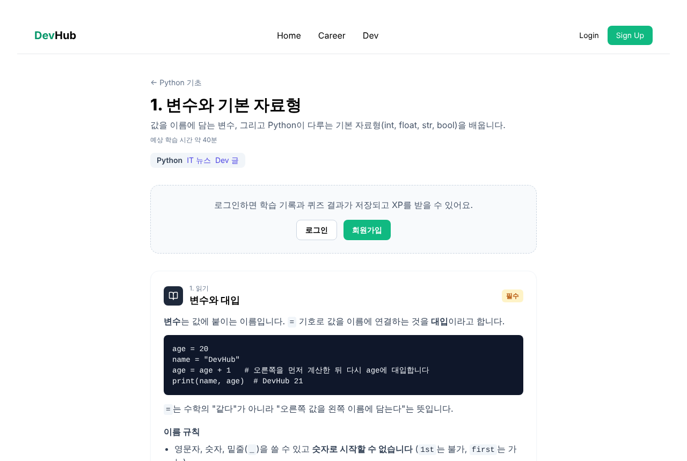
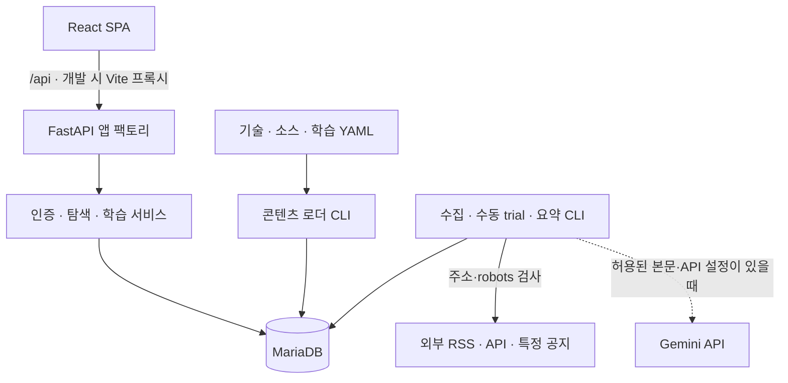

# DevHub 2.0

> IT 소식을 발견하고, 같은 기술의 개발 글을 탐색하고, 학습과 기록으로 이어 가는 개발자 학습 플랫폼

개발 입문자와 주니어 개발자는 기술 뉴스, 개발 아티클, 학습 자료를 여러 곳에서 찾습니다. DevHub 2.0은 **공통 기술 분류**로 콘텐츠 탐색과 학습을 연결하는 개인 포트폴리오 프로젝트입니다.

Home → News의 기술 필터 → Dev의 같은 기술 글 → Career 공개 단원 → 활동·퀴즈 → XP·학습 기록으로 이어지는 흐름을 구현했습니다. 비로그인 사용자는 공개 콘텐츠를 탐색하고, 로그인 사용자는 자신의 학습 상태와 목표를 저장합니다.

**현재 검증 범위**는 로컬 실행과 클라우드 실험 환경에서의 소량 수동 수집입니다. 자동 콘텐츠 공급과 공개 서비스 배포는 운영하지 않습니다. 기본 설치에는 Python·Kafka 학습 콘텐츠가 포함되며, 실제 뉴스·개발 글은 포함되지 않습니다.

[로컬 실행](#로컬-실행) · [주요 기능](#주요-기능과-현재-제약) · [검증 결과](#테스트와-실데이터-검증) · [상세 개발 가이드](docs/DEVELOPMENT.md)

## 주요 기능과 현재 제약

| 영역 | 사용자가 할 수 있는 일 | 조건과 범위 |
|---|---|---|
| Home `/` | 최신 뉴스 3건·개발 아티클 3건 확인, 기술 태그로 News 진입 | DB에 저장된 콘텐츠를 조회. 새 설치에서는 콘텐츠가 없는 안내 표시 |
| News `/news` | 기술 필터, 더 보기, 원문 이동, 최근 7일 기술 언급량·수집 상태 확인 | `?tech=<slug>`로 필터 유지. 동일한 정규화 URL의 기사는 대표 1건으로 표시 |
| Dev `/dev` | 채널 선택, 기술 필터 유지, 제공되는 지표에 따른 최신·인기 정렬 | 원문 링크 중심의 게시판. 정책상 표시 가능한 요약이 있을 때만 상단 아티클 영역 표시 |
| Career `/career` | Python·Kafka 트랙 탐색, 설명·외부 자료·실습·퀴즈 열람 | 비로그인 열람 가능. 학습 단원에 연결된 기술로 News·Dev 이동 |
| 내 학습 | 활동 완료 확인, 서버 퀴즈 채점, 진행률·이어서 학습·XP·레벨 확인 | 로그인 필요. 필수 활동과 퀴즈 통과 조건을 충족하면 단원 완료 보상 지급 |
| 진로 탐색 | 공개 직무의 기술·관련 학습 조회, 진로 후보 저장 | API와 UI 구현. 기본 직무 데이터는 아직 검토 중이어서 새 설치에서는 빈 목록 |
| 학습 목표 | 자유 목표 또는 직무·기술·트랙에 연결된 목표 관리 | 로그인 필요. 관련 공개 단원과 내 진행 상태 연결 |
| Settings `/settings` | 학습자 유형, 개인화 ON/OFF, 관심 기술·역량 자기 평가, 개인화 데이터 초기화 | 개인화 기본 OFF. ON/OFF가 데이터를 삭제하지 않으며 초기화는 관심·역량 데이터에만 적용 |

News와 Dev는 선택한 기술 slug를 공유합니다. `RelatedLearning`은 해당 기술에 연결된 **실제 공개 학습 단원**이 있을 때만 링크를 제공합니다. 개인별 추천 순위와 기사별 의미 분석 기능은 구현하지 않았습니다.

현재 공개된 학습 콘텐츠는 두 트랙에 각 1개 단원입니다.

| 트랙 | 단원 | 구성 |
|---|---|---|
| Python 기초 | 변수와 기본 자료형 | 활동 4개 중 필수 3개, 퀴즈 5문항 |
| Kafka 기초 | Kafka 핵심 개념 | 활동 5개 중 필수 4개, 퀴즈 5문항 |

두 단원의 퀴즈 통과 기준은 80%입니다. 활동은 학습자가 완료를 확인하는 방식이며, 실습 코드를 서버에서 실행해 평가하는 기능은 없습니다. XP와 자기 평가는 실제 기술 숙련도 인증으로 사용하지 않습니다.



*저장소에 보존된 Python 학습 화면 예시입니다. 이전 시점의 캡처이며, Kafka 실데이터 통합 시연 화면과는 구분합니다.*

## 기술 스택

아래 라이브러리 버전은 검증 커밋의 잠금 파일 기준입니다. Python과 Node.js는 저장소가 지정한 실행 버전입니다.

| 영역 | 주요 기술 |
|---|---|
| 백엔드 | Python 3.12, FastAPI 0.162.0, Pydantic 2.14.1, Uvicorn 0.54.0 |
| DB·스키마 | MariaDB 11.4.13, SQLAlchemy 2.0.55, Alembic 1.20.1 |
| 인증 | Argon2id, PyJWT 2.15.1, 회전형 refresh token |
| 수집·파일 처리 | HTTPX 0.28.1, feedparser 6.0.14, PyYAML |
| 선택적 AI 연동 | Google Gemini API, `google-genai` 2.34.0 |
| 프론트엔드 | Node.js 24, React 19.2.0, Vite 7.1.12, Tailwind CSS 3.4.18, Axios 1.13.2 |
| UI·표현 | React Router, Recharts, react-markdown·remark-gfm |
| 테스트·도구 | pytest 9.1.1, Ruff 0.17.3, Vitest 5.0.5, Playwright 1.63.0, uv, npm, GitHub Actions |

버전과 설치 그룹은 [백엔드 설정](backend/pyproject.toml), [uv.lock](backend/uv.lock), [프론트 설정](frontend/package.json), [프론트 lock](frontend/package-lock.json), [E2E 설정](e2e/package.json)에서 확인할 수 있습니다.

## 시스템 구조



- **웹과 외부 처리를 분리**했습니다. 웹 앱은 DB를 통해 콘텐츠와 사용자 데이터를 조회·저장하며, 수집·Gemini 호출은 별도 CLI에서 실행합니다. 웹 새로고침이 외부 수집을 유발하지 않습니다.
- **공통 콘텐츠와 개인 기록을 분리**했습니다. YAML로 트랙·활동·퀴즈를 관리하고, 사용자별 진행·응시·보상·목표를 별도 테이블에 저장합니다.
- **스키마 변경은 Alembic으로 관리**합니다. 0001~0011 마이그레이션과 SQLAlchemy 모델의 일치를 CI에서 검사합니다.
- **React는 서버 데이터를 조회**합니다. 인증 상태는 `AuthProvider`, 공개·개인 데이터 및 페이지 누적 로딩은 각 Hook에서 처리합니다.

| 경로 | 역할 |
|---|---|
| `backend/app/api`, `schemas`, `services`, `models` | HTTP·입출력 계약·도메인 처리·영속 모델 |
| `backend/app/core`, `db` | 환경설정·보안·오류·로깅·DB 세션과 안전성 검사 |
| `backend/app/jobs`, `integrations`, `summaries` | 작업 실행·외부 통신과 파싱·요약 검증 |
| `backend/app/content_loader`, `backend/content` | 파일 검증과 적재, 기술·소스·Python·Kafka 데이터 |
| `backend/alembic`, `backend/tests` | 마이그레이션과 단위·MariaDB 통합 테스트 |
| `frontend/src`, `e2e` | 화면·API 클라이언트와 브라우저 통합 테스트 |

## 핵심 기술 구현과 의사결정

### 1. 기술 기반 탐색을 학습으로 연결

독립적인 News·Dev·Career 화면을 연결하기 위해 콘텐츠와 학습 단원이 같은 기술 분류를 사용하도록 했습니다. Home 뉴스 태그가 News 필터로 이어지고, News의 Dev 링크와 Career 단원의 역방향 링크가 동일 slug를 전달합니다. `/api/technologies/{technology_slug}/units`는 공개된 트랙과 단원만 반환합니다.

이 동선은 합성 데이터 E2E와 Kafka 실데이터 수동 시연으로 확인했습니다. 태그 일치를 기반으로 한 탐색이므로 개별 글이 특정 단원의 학습 내용을 직접 설명한다고 단정하지 않습니다. [공개 단원 조회](backend/app/services/learning_catalog.py) · [학습 연결 UI](frontend/src/components/feed/RelatedLearning.jsx) · [통합 탐색 E2E](e2e/tests/related-learning.spec.js)

### 2. 재요청에도 일관된 학습 기록과 보상

퀴즈 제출 재시도로 응시 기록이나 보상이 중복되는 문제를 막기 위해, 사용자별 `client_submission_id`로 같은 제출 결과를 재사용합니다. XP는 `(user_id, idempotency_key)` UNIQUE 제약이 있는 원장에 기록합니다. 단원 완료 처리와 보상은 트랜잭션 안에서 수행하고, 레벨은 원장의 누적 XP로 계산합니다.

응시 기록이 있는 퀴즈의 내용이 바뀌면 새 버전을 공개하고 이전 버전은 retired 상태로 보존합니다. 기존 응시와 완료·XP 기록을 유지하는 동작도 검증했습니다. [학습 진행 서비스](backend/app/services/learning_progress.py) · [보상 원장](backend/app/services/rewards.py) · [콘텐츠 적재](backend/app/content_loader/loader.py)

### 3. 비로그인 탐색과 사용자별 데이터 경계

공개 목록과 학습 자료는 계정 없이 조회할 수 있습니다. 개인 API는 토큰에서 현재 사용자를 결정하며, 다른 사용자 ID를 입력받아 기록을 조회하는 방식을 사용하지 않습니다. 목표 소유권, 개인화 데이터 격리, 공개 응답이 개인 설정에 영향받지 않는지를 통합 테스트로 확인합니다.

Access token은 브라우저 메모리에 두고 refresh token은 `HttpOnly`·`SameSite=Strict` 쿠키로 전달합니다. DB에는 refresh token 해시를 저장하고 갱신 시 회전시킵니다. 클라이언트는 동시 갱신 요청을 하나로 합칩니다. [요청 인증](backend/app/api/deps.py) · [인증 서비스](backend/app/services/auth.py) · [API 클라이언트](frontend/src/api/client.js)

### 4. 반복 수집과 재태깅의 데이터 정합성

URL의 추적 파라미터와 fragment를 제거하고 해시를 계산해 `(source_id, url_hash)`로 중복 저장을 방지합니다. 수집 소스별 저장은 유지하면서 News 표시 단계에서는 동일 해시의 대표 글을 선택합니다. 서로 다른 URL의 유사 기사까지 묶지는 않습니다.

기술 태깅은 제목·필요한 메타데이터·원문 태그의 규칙 매칭입니다. 규칙 태그를 갱신할 때 manual 등 비규칙 태그를 보존하고 같은 기술을 다시 삽입하지 않아 기본키 충돌을 방지합니다. 일반 수집은 소스별 잠금과 실행 기록을 남깁니다. [저장기](backend/app/jobs/store.py) · [태깅](backend/app/services/tagging.py) · [수동 태그 회귀 테스트](backend/tests/integration/test_manual_tags.py)

### 5. 수집·소개문·AI 처리의 정책 분리

접속 성공만으로 저장이나 AI 처리를 허용하지 않도록 일반 수집은 `status: active`와 `options.terms: approved`를 확인합니다. 소개문 저장·표시는 별도 `excerpt` 옵션, AI 요약은 별도 `ai_summary` 설정으로 제어합니다. 일반 수집에서는 저장하지 않는 소개문도 태깅 입력으로 사용할 수 있어, 저장 옵션과 일시적 처리를 구분합니다.

AI 요약은 HTML·Markdown 본문을 정제한 뒤 입력량·호출 예산을 검사하고 News·Dev별 JSON 스키마를 검증합니다. 입력 부족·오류는 건너뜀이나 실패 상태로 기록하고, 제목만으로 대체 요약을 만들지 않습니다. 생성 결과는 DB에 저장하며 웹에서는 표시 정책을 다시 확인합니다. [소스 정책](backend/app/services/source_terms.py) · [요약 엔진](backend/app/summaries/summarizer.py) · [요약 작업](backend/app/jobs/summarize.py)

## 콘텐츠 공급과 AI의 현재 상태

| 항목 | 구현과 현재 상태 |
|---|---|
| 일반 수집 | RSS/Atom 및 일부 공식 API 어댑터, 정규화·중복 방지·소스별 실패 격리·실행 기록 구현 |
| 기본 소스 | 국내 후보 19개 등록. 일반 저장 수집이 승인된 소스 0개, `ai_summary`가 켜진 소스 0개 |
| 정기 실행 | 그룹별 허용 목록과 cron 줄 생성 구현. 현재 News·Dev 허용 목록이 비어 있으며 정기 수집을 운영하지 않음 |
| 수동 실험 `trial` | 특정 공지 HTML과 Atom 특정 항목을 선택해 최대 2건, 최대 48시간 범위에서 시험하는 독립 명령 |
| 진단·dry-run | 실제 외부 요청이 발생함. `diagnose`와 `trial --dry-run`은 DB에 연결하지 않음. 일반 `collect --dry-run`은 DB의 소스 설정을 읽고 저장하지 않음 |
| Gemini 요약 | 엔진·결과 저장·API·카드 출력 구현. 기본 소스에 현재 적용하지 않음. API 키만 추가해도 요약이 켜지는 구조가 아님 |

AI 작업에는 `GEMINI_API_KEY`, 선택적 `GEMINI_MODEL`, 요약이 허용된 소스, 충분한 본문 입력이 필요합니다. `--body URL=FILE`로 보유한 HTML·Markdown을 제공할 수 있습니다. 현재 설정에는 자동 본문 확보 대상으로 등록된 소스가 없습니다. 본문 전체를 DB에 영구 저장할 필요는 없지만, 입력 확보와 외부 전송의 이용 조건은 별도로 확인해야 합니다.

수동 실험은 실행 목록의 범위·기간, 요청 호스트, robots, 실제 연결 DB·계정을 검사합니다. 재시도와 리다이렉트를 하지 않으며 저장 출처는 `paused`, `terms: unverified`, AI 비활성 상태로 생성됩니다. 실제 계정의 DB 권한은 실행 전 별도 확인해야 합니다. [수동 실험 안내](docs/devhub-2.0/DevHub-2.0-Manual-Trial.md)

## 테스트와 실데이터 검증

### 최신 main CI

검증 기준은 **`29263ac29254f6077c02fb071424290e8e61c9f8`**, 확인일은 **2026-11-05**입니다. PR #22 병합 후 main의 [GitHub Actions 실행](https://github.com/jinhansol/IT-Trend-Fusionb-server/actions/runs/41972933440)과 job 로그에서 다음 결과를 확인했습니다.

| 검사 | 결과 | 주요 검증 범위 |
|---|---|---|
| Backend | pytest 897건 통과 | 인증·데이터 격리·로더·수집·요약·진행·보상, Ruff, MariaDB 통합, Alembic·콘텐츠 검증 |
| Frontend | Vitest 94건 통과, 빌드 성공 | API 오류·인증 상태·공개 탐색·학습·설정, 지정 파일 필수 ESLint |
| E2E | Playwright 14건 통과 | 합성 데이터를 사용한 탐색 동선, 로그인·기록 유지, 목표·개인화, 모바일 화면 |
| Secret scan | 성공 | GitHub Actions의 비밀정보 검사 |

테스트는 회귀를 확인하는 근거이며, 외부 공급원의 현재 가용성이나 모든 환경에서의 실행을 보장하지 않습니다. 테스트 DB는 개발 DB와 계정을 분리하며 실행 전 실제 연결 DB를 확인합니다. 백엔드 테스트와 E2E는 같은 테스트 DB를 사용하므로 동시에 실행하지 않습니다.

### 소량 실데이터 수동 시연

2026-11-05 실험 실행 기록에서는 클라우드의 `devhub_experiment`에 Kafka 관련 **News 공지 1건과 Dev 글 1건**을 저장하고 기술 태깅, API 조회, Home·News·Dev 표시, 동일 URL 재처리 시 신규 0건을 확인했습니다. 실제 글·시연 계정·DB 덤프는 저장소에 포함하지 않습니다.

| 검증 기록 | 확인한 범위 |
|---|---|
| Kafka 퀴즈 v1 | 실제 News·Dev를 이용한 9단계 동선, 활동 완료·퀴즈 통과·100 XP·재로그인 후 기록 유지 |
| Kafka 퀴즈 v2 | 수정 콘텐츠 재적재 후 기존 v1 기록·완료·XP 유지, 새 사용자의 v2 5/5 통과와 100 XP 확인. 전체 9단계를 v2로 다시 수행하지는 않음 |

Dev 글은 개별 글의 CC BY 4.0 표시를 확인한 범위로 활용했습니다. News 공지는 재사용 조건의 미확인이 남아 있어 본인 확인용 임시 실험에 한정했습니다. 이 기록을 외부 공개나 추가 수집의 이용허락으로 사용하지 않습니다. 현재 일반 카드의 라이선스 링크는 AI 요약 영역에만 표시되므로 공개 재사용 시 표시 조건도 별도 확인해야 합니다.

## 로컬 실행

필요 도구는 Git, uv, Python 3.12, Node.js 24, Docker Compose입니다. 아래는 **새 체크아웃에서 실행하는 Bash 명령**입니다. PowerShell과 환경 오류 해결은 [상세 개발 가이드](docs/DEVELOPMENT.md)를 참고하세요. Windows PC에서의 실제 전체 실행은 별도 검증이 필요합니다.

```bash
git clone https://github.com/jinhansol/IT-Trend-Fusionb-server.git
cd IT-Trend-Fusionb-server

# 로컬 DB 설정. 기존 .env가 있다면 덮어쓰지 않고 내용을 확인합니다.
cp .env.example .env
docker compose up -d --wait mariadb

cd backend
cp .env.example .env
uv sync --locked
uv run alembic upgrade head
uv run python -m app.content_loader technologies content/technologies.yaml
uv run python -m app.content_loader sources content/sources.yaml
uv run python -m app.content_loader load content/python content/kafka
uv run uvicorn app.main:create_app --factory --reload
```

새 터미널에서 저장소 루트 기준으로 실행합니다.

```bash
cd frontend
npm ci
npm run dev
```

- 화면은 `http://localhost:5173`, API 문서는 `http://127.0.0.1:8000/api/docs`, DB 연결 확인은 `http://127.0.0.1:8000/api/health/ready`입니다.
- Vite가 `/api`를 `127.0.0.1:8000`으로 전달합니다. 기본 웹 실행과 Career 학습에는 Gemini API 키가 필요하지 않습니다.
- Compose는 로컬 `127.0.0.1:3307`에 MariaDB를 열고 개발용 `devhub_dev`와 테스트용 `devhub_test`를 별도 계정으로 생성합니다. 예제 인증정보는 로컬 개발용입니다. 실제 비밀키와 `.env`는 커밋하지 않습니다.
- 기본 적재로 Python·Kafka를 학습할 수 있습니다. News·Dev는 빈 상태가 정상이며, 진로 직무 후보는 [검토 자료](docs/devhub-2.0/review/careers/README.md)로 분리돼 있습니다.
- 콘텐츠 로더는 재적재 시 기존 slug를 갱신하고, 퀴즈 변경은 버전으로 관리합니다. 로더의 `--dry-run`은 DB에 접속해 변경을 계산한 뒤 롤백합니다.
- 작업 종료 시 서버 터미널에서 `Ctrl+C`, 저장소 루트에서 `docker compose stop`을 실행하면 DB 데이터를 유지한 채 정지할 수 있습니다.

테스트는 DB 컨테이너를 띄운 뒤 각 디렉터리에서 순서대로 실행합니다.

```bash
# backend/
uv run ruff check
uv run ruff format --check
uv run pytest

# frontend/
npm run lint
npm test
npm run build

# e2e/
npm ci
npx playwright install chromium
npx playwright test
```

## 현재 한계와 후속 개선 후보

- 현재 학습 분량은 Python·Kafka 각 1개 단원입니다. 추가 Python 단원과 직무 데이터는 검토 자료이며 기본 적재 대상에 포함되지 않습니다.
- 실제 콘텐츠 자동 공급, 배포·장기 수집, 개인별 추천 순위, 기사 의미 기반 추천과 실시간 트렌드 예측은 제공하지 않습니다. 차트는 수집된 글의 기술 언급량입니다.
- 현재 국내 콘텐츠에 대한 Gemini 요약 생성·저장·표시의 종단 검증은 완료되지 않았습니다. 입력 조건과 이용 범위가 충족될 때 따로 검증해야 합니다.
- 동일 URL 중복을 처리하며 서로 다른 URL의 유사 내용까지 식별하지 않습니다. 규칙 태깅의 실데이터 정확도를 대표하는 수치는 측정하지 않았습니다.
- 후속 정리 후보는 미사용 의존성, 전체 ESLint의 CI 필수화, 문서·화면 메타데이터 정합성입니다. 새로운 기능 개발이나 장기 운영을 프로젝트 완료 조건으로 두지 않았습니다.

## 프로젝트 이력과 문서

DevHub 1.0의 정보 탐색 기능에서 출발해 2.0에서는 인증·학습 데이터 모델과 실행 경계를 새로 구성했습니다. PR #17에서 기술 기반 탐색 연결, #18에서 제한적 수동 수집, #19에서 Kafka 콘텐츠를 추가했습니다. PR #20의 회귀·문서 정리 후 #21에서 1.0 전용 파일 67개를 제거하고, #22에서 중복 설정과 루트 npm 파일 3개를 제거했습니다. 검증 커밋의 추적 파일은 324개입니다.

| 보존 태그 | 대상 | 용도 |
|---|---|---|
| [legacy-final-project](https://github.com/jinhansol/IT-Trend-Fusionb-server/tree/legacy-final-project) | `bcdf13c` | DevHub 1.0 최종 소스 |
| [devhub-v2-pre-legacy-cleanup](https://github.com/jinhansol/IT-Trend-Fusionb-server/tree/devhub-v2-pre-legacy-cleanup) | `b02f6fd` | 레거시 제거 직전의 1.0·2.0 혼합 상태 |

| 문서 | 내용 |
|---|---|
| [개발 가이드](docs/DEVELOPMENT.md) | 환경변수, DB, 로컬 실행, 테스트, 종료 |
| [설계·검토 기록](docs/devhub-2.0/README.md) | 시점별 정책·설계·검증 문서 |
| [수동 실험 안내](docs/devhub-2.0/DevHub-2.0-Manual-Trial.md) | 대상·이용 근거·기간·전용 DB·실행 목록 |
| [학습 목표 설계](docs/devhub-2.0/DevHub-2.0-P3-Design.md) | 직무·후보·목표의 데이터와 정책 |
| [개인화 설정 설계](docs/devhub-2.0/DevHub-2.0-P4-Design.md) | ON/OFF, 관심·역량, 초기화 범위 |

설계 문서는 작성 당시의 의사결정 기록입니다. 현재 구현·검증 상태는 위 기준 커밋과 테스트 결과를 기준으로 읽어 주세요. 저장소명 `IT-Trend-Fusionb-server`와 npm 패키지명 `it-trend-frontend`는 기술 식별자로 유지하며 프로젝트 표시명은 DevHub 2.0을 사용합니다.
