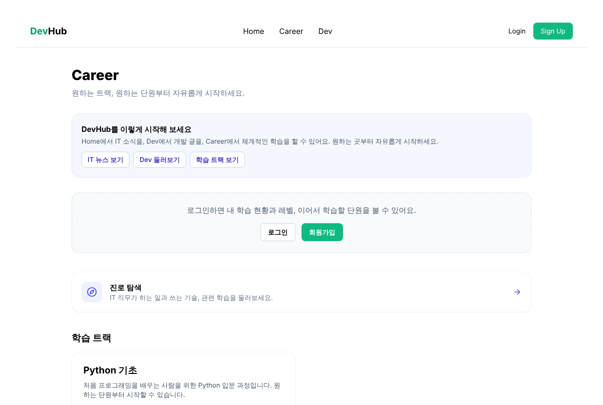
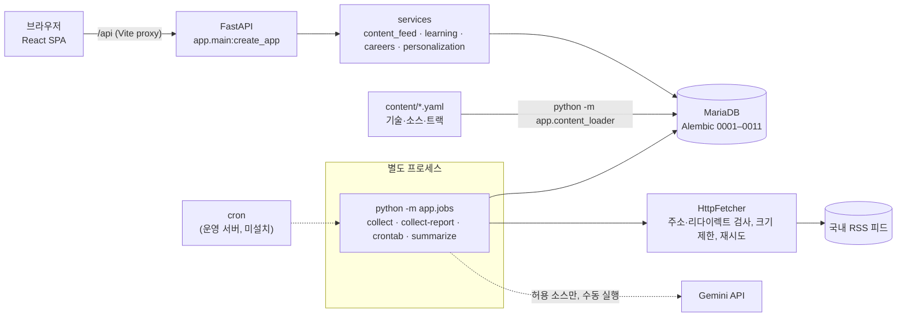
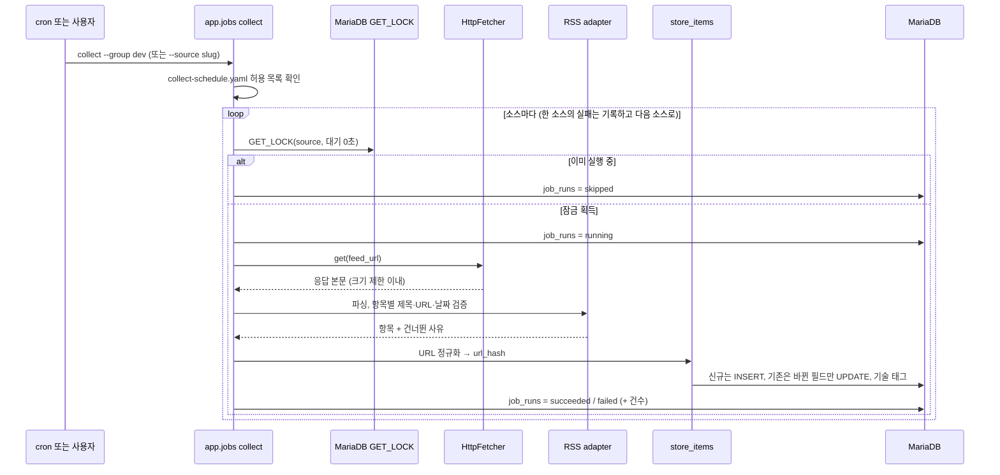

# DevHub 2.0

> 국내 IT 뉴스와 국내 개발 기술 블로그를 한곳에서 탐색하고, 관심 기술을 Career 학습으로 이어 가는 개발자 정보 플랫폼

DevHub 2.0은 학교 파이널 프로젝트였던 DevHub 1.0을 새 백엔드·새 스키마로 다시 만든 개인 프로젝트입니다. 화면에 보이는 정보는 모두 DB에 저장된 내용이며, 수집·AI 처리는 웹 요청과 분리된 별도 작업으로만 실행됩니다.

| | |
| :--- | :--- |
| **구성** | Home(뉴스·개발 아티클 요약) · News · Dev · Career(학습·진로) |
| **백엔드** | FastAPI · SQLAlchemy 2 · Alembic · MariaDB 11.4 |
| **프론트엔드** | React 19 · Vite 7 · Tailwind CSS 3 |
| **테스트** | pytest(단위 + MariaDB 통합) · Vitest · Playwright E2E · GitHub Actions |
| **개발 형태** | 1인 개발 |

<p>
  
  
</p>

<sub>저장소의 실제 학습 콘텐츠(`backend/content/python`)를 로컬에서 실행한 화면입니다. Home·News·Dev의 실제 콘텐츠는 수동 실험으로 로컬 실험 DB에서만 검증했고(아래 "로컬 실데이터 검증"), 이용 조건 때문에 그 데이터와 화면은 저장소에 싣지 않았습니다.</sub>

---

## 왜 만들었나

개발자는 기술 소식(뉴스), 실무 경험(기업 기술 블로그), 학습(강의·문서)을 각기 다른 곳에서 찾습니다. DevHub는 이 세 가지를 **기술 태그로 연결**해, 뉴스에서 본 기술을 Dev 글과 Career 학습 단원으로 바로 이어 볼 수 있게 하는 것을 목표로 합니다.

1.0에서 이 목표를 빠르게 구현하면서 드러난 문제가 2.0의 출발점입니다.

- 웹 요청 처리 중에 외부 검색·크롤링·LLM 호출이 함께 일어나 응답이 외부 사이트 상태에 묶여 있었습니다.
- 브라우저 자동화(Selenium)와 HTML 스크래핑, 자동화 탐지 회피 코드에 의존했습니다.
- 수집 콘텐츠의 이용 조건을 따로 확인하지 않았습니다.

2.0은 **웹 앱은 DB만 읽고, 수집과 AI는 별도 작업으로, 외부 콘텐츠는 이용 조건이 확인된 범위에서만** 쓰는 구조로 다시 설계했습니다.

## 핵심 기능

| 화면 | 기능 |
| :--- | :--- |
| **Home** (`/`) | 최신 IT 뉴스 3건 + 최신 개발 아티클 3건을 나란히 보여 주고, News·Dev·Career로 이동하는 진입점 |
| **News** (`/news`) | 국내 IT 뉴스 목록, 기술 필터(주소에 `?tech=` 유지), 더 보기, 최근 7일 기술 언급량 차트, 마지막 수집 시각·지연 표시. 여러 매체가 같은 기사(정규화 URL이 같은 글)를 실으면 한 건으로 묶어 표시 |
| **Dev** (`/dev`) | 국내 기업 기술 블로그·개발 커뮤니티를 채널별 게시판으로 표시(제목·출처·게시일·원문 링크). 이용 조건이 확인된 소스의 AI 요약 글이 있을 때만 상단에 최대 2건 강조, 없으면 영역을 숨김 |
| **Career** (`/career`) | 파일(YAML)로 관리하는 학습 트랙·단원·퀴즈(공개 트랙: **Python 기초**, **Kafka 기초**), 필수 활동 확인·퀴즈 채점·단원 완료 XP·레벨·진행 기록, 진로(직무) 탐색, 학습 목표, 기술 단위로 News·Dev와 상호 연결 |
| **계정·설정** | 회원가입·로그인(JWT access token + httpOnly refresh 쿠키), 학습자 유형(선택), 개인화 설정(기본 꺼짐), 관심 기술·역량 자기 평가 |

- 게스트도 Home·News·Dev·Career 공개 콘텐츠를 모두 볼 수 있습니다. 개인화 데이터는 공개 응답에 영향을 주지 않습니다(테스트로 고정).
- 개인화 추천(P5)과 News→Dev 연관 글 추천은 데이터 부족으로 **구현하지 않았습니다**(News→Dev는 검토 결과 NO-GO로 보류).

## 기술 스택과 선택 이유

| 영역 | 선택 | 이유 |
| :--- | :--- | :--- |
| API | FastAPI, Pydantic v2 | 요청·응답 스키마를 코드로 고정하고 문서(`/api/docs`)를 자동 생성 |
| ORM·스키마 | SQLAlchemy 2, Alembic | 스키마 변경을 마이그레이션(현재 0001~0011)으로만 관리. CI에서 `alembic check`로 모델과 마이그레이션 불일치를 차단 |
| DB | MariaDB 11.4 (Docker Compose) | 개발·테스트 DB와 계정을 분리해, 테스트가 개발 데이터를 건드릴 수 없게 함 |
| 수집 | httpx, feedparser | 공식 RSS/API만 사용. 브라우저 자동화 없이 타임아웃·크기 제한·리다이렉트 검사를 직접 통제 |
| 동시 실행 제어 | MariaDB `GET_LOCK`, `flock` | 같은 소스·같은 수집 그룹이 겹쳐 실행되지 않게 함(별도 큐·브로커 없이) |
| 정기 실행 | cron (생성 명령 제공) | 상시 실행 스케줄러 프로세스 없이 운영 서버의 cron이 수집 명령을 호출 |
| AI 요약 | Google Gemini (`google-genai`) | 요약을 JSON 스키마로 검증하고, 호출 상한·실패 분류를 기존 요약 엔진에 맞춤 |
| 인증 | argon2id, JWT(HS256), httpOnly 쿠키 | 비밀번호 해시와 짧은 access token, refresh token은 쿠키로만 전달 |
| 프론트 | React 19, Vite 7, Tailwind CSS 3 | 개발 서버 프록시로 API와 같은 출처를 유지(refresh 쿠키 동작) |
| 테스트 | pytest, Vitest, Playwright | 단위·DB 통합·브라우저 E2E를 CI에서 모두 실행 |
| 의존성 | uv (`uv.lock`), npm (`package-lock.json`) | CI와 로컬이 같은 잠금 파일로 설치 |

## 시스템 구조와 수집 파이프라인



웹 앱은 외부 사이트와 LLM을 호출하지 않습니다. 이 경계는 소스 코드의 import 관계를 검사하는 테스트(`tests/unit/test_summary_boundaries.py`)로 고정되어 있습니다.

<details>
<summary><b>수집 한 번의 처리 흐름 (시퀀스)</b></summary>



- 같은 소스 안에서 `(source_id, url_hash)`가 UNIQUE라 다시 수집해도 행이 늘지 않습니다.
- `--dry-run`은 가져오기·파싱만 하고 `job_runs`도 기록하지 않습니다.
- 정기 수집(`--group`)은 Gemini를 호출하지 않습니다. AI 요약은 `summarize` 명령을 따로, 호출 상한(`--max-calls`)과 함께 실행합니다.

</details>

## 로컬 실데이터 검증 (2026-11-05)

### 일반 수집과 수동 실험(trial)

| | 일반 RSS/API 수집 (`collect`) | 수동 실험 (`trial`) |
| :--- | :--- | :--- |
| 대상 | `sources.yaml`에서 이용 조건이 승인된(`options.terms: approved`) 소스 전체 | 실행 목록(저장소 밖 YAML)에 적은 원문 1건씩, 최대 2건 |
| 현재 상태 | **정상 운영되는 자동 공급 아님**. 승인된 소스가 News 0곳, Dev 0곳이고 정기 실행(cron)도 설치하지 않음 | 실제 News 1건과 Dev 1건을 수집·저장·표시함 |
| 저장 범위 | 승인된 소스 정책에 따름 | 제목·원문 URL·출처·게시일(+ 허용 시 저자)만. 본문·소개문·이미지·다른 피드 항목은 저장하지 않음 |
| 안전장치 | 승인 게이트, 허용 목록, robots.txt, 주소·리다이렉트 검사 | 위 검사에 더해 아래를 적용 |

수동 실험(trial)에만 적용되는 안전장치:
- 실행 목록의 기간을 최대 48시간으로 제한하고, 요청 직전·첫 쓰기 직전·커밋 직전에 만료를 다시 확인합니다.
- robots.txt 규칙을 읽지 못하면 거부합니다.
- 재시도와 리다이렉트를 하지 않고, 입력 호스트에만 요청합니다.
- 실제 쓰기 연결의 DB명·계정명이 `devhub_experiment`인지 확인합니다.

실험으로 만든 출처는 `paused`, `terms: unverified`로 저장되므로 일반 `collect`나 AI 요약 대상이 되지 않습니다. 실행 방법은 [수동 실험 안내](docs/devhub-2.0/DevHub-2.0-Manual-Trial.md)에 있습니다.

### 결과

- **실데이터:** 클라우드 실험 환경의 전용 DB(`devhub_experiment`, 전용 계정, 루프백 전용)에 Kafka 주제의 News 공지 1건과 Dev 블로그 글 1건을 저장했습니다.
  - 두 글 모두 `kafka` 기술로 자동 태깅되어 Home·News·Dev에 표시됐습니다.
  - 같은 URL을 다시 저장해도 새 행은 0건이었습니다.
- **기술 `kafka` 기반 통합 탐색:** Home의 Kafka 태그로 `/news?tech=kafka`에 가고, "같은 기술의 Dev 글 보기"로 `/dev?tech=kafka`에 갑니다. 거기서 관련 학습 링크로 Career "Kafka 기초" 단원에 이어집니다.
- **실제 콘텐츠 데이터는 이 GitHub 저장소에 포함되지 않습니다.** 저장소에는 수집 코드, 합성 테스트 픽스처, 학습 콘텐츠(YAML)만 있습니다.

| 검증 | 내용 | 결과 |
| :--- | :--- | :--- |
| **Kafka v1** (최초 단원) | 실제 News·Dev 콘텐츠로 9단계 동선. Home → Kafka News → Kafka Dev → Career 단원 → 회원가입 → 필수 활동 4/4 → 퀴즈 통과(+100 XP, Lv 2) → 재로그인 후 기록 유지 → 단원 상태 유지 | 9단계 모두 통과 |
| **Kafka v2** (설명 수정 후) | 수정된 학습 설명과 퀴즈를 다시 적재(퀴즈 v2 공개, v1 응시 기록 보존). 새 사용자가 단원부터 v2 퀴즈를 채점받고 완료 XP를 받는지, 기존 사용자의 완료·XP가 유지되는지 확인. **9단계 동선 전체를 v2로 다시 실행하지는 않음** | 새 사용자 5/5 통과·+100 XP, 기존 사용자 기록 유지 |

### 제한 사항

- **이용 조건**
  - Dev 글: 그 글 하나에 대해서만 CC BY 4.0 표시를 확인했습니다.
  - News 공지: 약관 조항을 확인하지 못해, 본인만 보는 로컬 임시 저장으로만 사용했습니다.
- **라이선스 표시:** 일반 카드는 출처·저자·게시일·원문 링크를 표시하지만, 라이선스 링크는 AI 요약 영역에서만 나옵니다.
- **공지 파서:** 특정 사이트의 `__NEXT_DATA__` 구조에 의존합니다. 구조가 바뀌면 추측하지 않고 실패합니다.
- **실행 환경:** 검증은 회수될 수 있는 클라우드 컨테이너에서 했습니다. 장기 운영과 서버 배포는 계획하지 않습니다.

## 문제 해결 사례

실제로 겪은 일과 예방 차원의 설계를 구분해 적었습니다. 성능 수치는 측정하지 않아 싣지 않았습니다.

<details open>
<summary><b>1. 같은 글이 반복 수집될 때 중복 저장 방지</b> (예방 설계 → 실데이터로 검증)</summary>

- **문제**: RSS는 매번 최근 N건을 다시 내려주고, 같은 기사가 `utm_*` 같은 추적 파라미터만 바뀐 URL로 들어오기도 합니다.
- **판단**: 중복 판단을 애플리케이션 조건문이 아니라 DB 제약으로 보장합니다. 여러 매체에 같은 기사가 실리는 경우는 매체별 지표를 잃지 않도록 저장은 따로, 표시만 묶습니다.
- **대응**: URL을 정규화(호스트 소문자, 추적 파라미터·`#` 제거)한 해시로 `(source_id, url_hash)` UNIQUE 제약. 이미 있는 글은 바뀐 필드만 갱신. Home·News 목록은 같은 해시를 한 건으로 묶어 대표 글을 결정적으로 선택.
- **검증**: 개발 DB에서 같은 피드를 다시 수집했을 때 신규 0건(뉴스 20건·블로그 10건 각각). `test_collect_urls.py`, `test_news_dedupe.py`, `test_collector.py`.
- **한계(미해결)**: URL이 다른 같은 내용(슬러그 변경, 다른 매체의 같은 보도)은 묶지 못합니다.

</details>

<details>
<summary><b>2. 수집 실패 원인 분리: 네트워크 제한·주소 변경·사이트 차단</b> (실제 장애)</summary>

- **문제**: 클라우드 개발 환경에서 등록 소스 27곳 중 다수가 수집에 실패했습니다.
- **원인 분리**: 수집기와 프록시 기록으로 실패 유형을 나눴습니다.
  - 실행 환경의 네트워크 허용 목록 밖 → 연결 단계 거부(사이트에 도달하지 않음)
  - RSS 주소 이전 → 404 (ITWorld Korea, ZDNet Korea)
  - 사이트 보안 정책 → Cloudflare 403 (우아한형제들 기술 블로그)
- **판단**: 차단을 브라우저 위장 등으로 우회하지 않고, 원인별로 다르게 대응합니다.
- **대응**: 홈페이지가 안내하는 새 피드 주소로 갱신, 자동 접근을 막는 소스는 `paused`, 네트워크 제한 소스는 다른 실행 환경에서 재검증하도록 분리.
- **검증**: 새 주소로 실제 파싱 성공(ITWorld 20건, ZDNet 30건, dry-run).
- **추가 확인**: 이후 ITWorld의 robots.txt가 모든 크롤러에 `/feed/` 경로를 금지하는 것을 확인해, 파싱은 되지만 소스를 `paused`로 바꿔 전체·정기 수집에서 제외했습니다(테스트로 고정).
- **미해결**: 클라우드에서 막힌 국내 소스 9곳은 아직 검증 전입니다([로컬 검증 절차](docs/DEVELOPMENT.md#6-rss-접속파싱-테스트)).

</details>

<details>
<summary><b>3. 이용 조건을 기준으로 한 수집 정책과 국내 중심 전환</b> (정책 변경)</summary>

- **문제**: 기술적으로 수집할 수 있다는 것과 화면에 다시 보여 줘도 된다는 것은 다른 문제였습니다.
  - 해외 매체의 RSS 약관은 "수정 없이 표시"만 허용하고 번역·2차 저작물을 금지했습니다.
  - 일부 국내 매체는 robots.txt로 피드 경로와 AI 봇을 막고 있었습니다.
- **판단**: RSS 공개, robots.txt 허용, 접속 성공을 이용 허락으로 보지 않습니다.
- **대응**:
  - 정기 수집은 `content/collect-schedule.yaml`의 **명시적 허용 목록**에 있는 소스만 실행(현재 News 0곳, Dev 0곳).
  - AI 요약은 소스별 검토 스위치(`ai_summary`)가 켜진 소스에만, 페이지 단위 라이선스 확인을 거쳐 실행.
  - 해외 소스와 영→한 번역 기능을 제거하고 국내 한국어 소스만 남김. 번역 테이블은 마이그레이션을 피하려고 미사용 상태로 유지.
- **검증**: 번역 코드가 다시 들어오지 않도록 하는 테스트, 저장소 소스가 국내 한국어 RSS뿐인지 확인하는 테스트.
- **미해결**: 국내 소스의 재표시 허락은 아직 확정되지 않았습니다.

</details>

<details>
<summary><b>4. 외부 주소 요청의 안전장치</b> (예방 설계)</summary>

- 모든 요청 주소와 리다이렉트 대상을 검사합니다: http(s)만, 사용자 정보가 든 주소·localhost·사설 IP(레거시 IPv4 표기 포함) 거부, https→http 전환 거부, 쿠키 미저장, 응답 크기 상한, 429/5xx만 제한적으로 재시도.
- 기사 본문을 가져오는 경로는 허용한 호스트에만 연결하도록 잠그고, 프록시를 거치지 않을 때는 DNS 결과가 공인 IP인지도 확인합니다.
- **미해결**: DNS 확인 결과와 실제 연결 IP를 고정하지 않습니다(공개 서비스 전 재검토 대상).

</details>

<details>
<summary><b>5. 개발 DB 백업과 선택적 초기화</b> (운영 절차)</summary>

- **상황**: 국내 중심 전환 후 해외 콘텐츠 30건과 그에 딸린 요약·번역·태그를 지워야 했지만, 계정·학습 기록은 그대로 두어야 했습니다.
- **대응**: `mariadb-dump` 백업 → 임시 DB에 복원해 전 테이블 행 수·체크섬 비교 → 외래키를 확인하고 사용 종료(retired) 소스의 콘텐츠 행만 한 트랜잭션에서 삭제. `DROP DATABASE`·`TRUNCATE`는 쓰지 않았습니다.
- **검증**: 삭제 후 콘텐츠 관련 테이블만 바뀌고 나머지 24개 테이블은 체크섬까지 동일.

</details>

## 로컬 실행 요약

Windows 기준 상세 절차와 오류 해결은 **[docs/DEVELOPMENT.md](docs/DEVELOPMENT.md)** 에 있습니다. 명령은 저장소 설정 파일과 CLI 코드에서 확인한 것이며, **Windows PC에서의 실제 실행은 아직 검증하지 않았습니다**(Linux 환경에서 같은 명령의 동작만 확인).

```powershell
# 0) 필요 도구: Git, uv(Python 3.12 자동 설치), Node.js 24, Docker Desktop
# 1) DB (저장소 루트)
Copy-Item .env.example .env
docker compose up -d --wait mariadb          # 127.0.0.1:3307, devhub_dev / devhub_test

# 2) 백엔드
cd backend
Copy-Item .env.example .env
uv sync
uv run alembic upgrade head
uv run python -m app.content_loader technologies content/technologies.yaml
uv run python -m app.content_loader sources content/sources.yaml
uv run python -m app.content_loader load content/python content/kafka   # Python 기초 · Kafka 기초 트랙
uv run uvicorn app.main:create_app --factory --reload     # http://127.0.0.1:8000/api/docs

# 3) 프론트엔드 (새 터미널)
cd frontend
npm ci
npm run dev                                   # http://localhost:5173
```

백엔드 진입점은 2.0 앱 팩토리 `app.main:create_app`(`--factory`)입니다. 1.0의 실행 코드(`backend/main.py` 등)는 main에서 제거되었습니다(아래 "1.0 → 2.0 주요 변화").

수집은 웹 서버와 별개입니다. `uv run python -m app.jobs diagnose`는 DB 없이 **저장하지 않고** robots.txt 확인 후 접속·파싱·공급량만 확인합니다. 저장 수집(`collect`)은 `sources.yaml`에서 이용 조건이 승인된(`options.terms: approved`) 소스만 실행되며, 현재 승인된 소스는 없습니다. 실제 글 1~2건의 검증은 별도 수동 실험 명령(`uv run python -m app.jobs trial <실행 목록> [--dry-run]`)과 실험 전용 DB로 합니다([안내](docs/devhub-2.0/DevHub-2.0-Manual-Trial.md)).

## 테스트와 현재 개발 상태

| 구분 | 결과 (2026-11-05, `main` `797087f`의 [GitHub Actions 실행](https://github.com/jinhansol/IT-Trend-Fusionb-server/actions/runs/41946106634) 기준) |
| :--- | :--- |
| 백엔드 | pytest 894개 통과 (단위 + MariaDB 통합), ruff, 마이그레이션 검사. robots.txt UTF-8 BOM 회귀 테스트를 더한 이 변경에서는 로컬 897개 통과 |
| 프론트엔드 | Vitest 94개 통과, ESLint(2.0 파일), 빌드 |
| E2E | Playwright 14개 시나리오 통과 |
| CI | GitHub Actions 4개 job 모두 통과: Backend · Frontend · E2E · Secret scan |

**완료(코드·테스트로 확인)**

- Home·News·Dev·Career 화면과 공개 API, 인증, 학습 진행·퀴즈·XP, 진로 탐색·학습 목표, 개인화 설정
- Career 공개 트랙 2개(Python 기초, Kafka 기초)와 기술 `kafka` 기준의 Home·News·Dev·Career 통합 탐색
- 수동 실험 명령(`app.jobs trial`)으로 실제 News 1건·Dev 1건을 실험 전용 DB에 저장·태깅·표시 (위 "로컬 실데이터 검증")
- RSS/API 수집기(중복 방지, 오류 격리, 동시 실행 잠금, 수집 기록), 정기 수집 그룹·cron 줄 생성(재설치 시 중복 방지), 수집 통계 리포트
- Gemini 요약 엔진(JSON 스키마 검증, 호출 상한, 실패 분류, 결과 재사용). 실제 Gemini 호출로 요약 생성·저장·표시를 검증한 것은 **과거 PoC**(합성 기사와 당시 소스 1건)이며, 지금은 요약이 허용된 국내 소스가 없어 어떤 콘텐츠에도 자동 적용되지 않습니다

**아직 운영되지 않는 것**

- **실제 콘텐츠 자동 공급**: 국내 소스의 이용 조건이 확정되지 않아 자동 수집 허용 소스가 **News 0곳, Dev 0곳**입니다. 실제 글은 수동 실험으로 로컬 실험 DB에만 2건 저장해 검증했고, 개발 DB의 Home·News·Dev와 이 저장소에는 실제 콘텐츠가 없습니다.
- **정기 실행**: cron 구성은 코드로 준비됐지만(`python -m app.jobs crontab`), 운영 서버에 설치하지 않았습니다(배포 없음).
- **미구현**: 개인화 추천(P5), News→Dev 연관 글(NO-GO 보류), URL이 다른 같은 기사 묶기(현재는 정규화 URL이 같은 경우만 한 건으로 묶음).

## 1.0 → 2.0 주요 변화

| | DevHub 1.0 | DevHub 2.0 |
| :--- | :--- | :--- |
| 백엔드 구조 | 라우터에서 외부 검색·크롤링·LLM 호출 | 웹 앱은 DB만 읽음. 수집·AI는 별도 CLI 작업 |
| 콘텐츠 확보 | Naver·Google 검색, HTML 스크래핑(BeautifulSoup), Selenium(자동화 탐지 회피 포함) | 공식 RSS/API만. 주소·리다이렉트·크기 검사. 브라우저 자동화 없음 |
| 스케줄링 | 웹 프로세스 안의 APScheduler | 운영 서버 cron + 그룹별 잠금, 명시적 허용 목록 |
| 중복 처리 | 애플리케이션 로직 | DB UNIQUE 제약 + URL 정규화, 표시 단계 묶음 |
| AI | 수집 시 항상 요약(OpenAI) | 이용 조건이 확인된 소스만, 수동 실행·호출 상한·스키마 검증(Gemini) |
| 스키마 | `Base.metadata.create_all`로 생성 (마이그레이션 없음) | Alembic 마이그레이션 + CI 불일치 검사 |
| 테스트 | 자동화 테스트 없음 | pytest·Vitest·Playwright, CI 4개 job |
| 학습 기능 | 로드맵 화면 | 파일 기반 트랙·단원·퀴즈, XP·레벨, 진로·목표 |

현재 main의 공식 실행 버전은 DevHub 2.0(`backend/app/`, `frontend/src/`)이며, 1.0 전용 실행 코드는 main에서 제거했습니다. 이전 상태는 두 태그로 보존되어 있습니다.

| 태그 | 대상 커밋 | 내용 |
| :--- | :--- | :--- |
| `legacy-final-project` | `bcdf13c` | DevHub 1.0(학교 파이널 프로젝트)의 최종 상태 |
| `devhub-v2-pre-legacy-cleanup` | `b02f6fd` | 1.0 코드를 제거하기 직전의 main(1.0·2.0 코드가 함께 있는 상태) |

2.0 앱이 1.0 모듈을 불러오지 않는다는 점은 테스트(`tests/unit/test_app_startup.py`)로 계속 확인합니다.

## 문서

| 문서 | 내용 |
| :--- | :--- |
| [docs/DEVELOPMENT.md](docs/DEVELOPMENT.md) | Windows 로컬 실행, 콘텐츠 반영, 수집 dry-run·저장, 테스트, 오류 해결 |
| [수동 실험 안내](docs/devhub-2.0/DevHub-2.0-Manual-Trial.md) | `app.jobs trial`: 원문 1~2건, 최대 48시간, 실험 전용 DB와 계정 |
| [docs/devhub-2.0/](docs/devhub-2.0/README.md) | 설계·검토 기록 (작성 시점 기준) |
| [E0 소스 이용 조건 검토](docs/devhub-2.0/DevHub-2.0-E0-Source-Terms-Review.md) | 해외·국내 소스 약관·robots.txt 검토 |
| [1.0·2.0 수집 구조 비교](docs/devhub-2.0/DevHub-2.0-News-Collection-Architecture-Comparison.md) | 1.0 수집 방식과 2.0 재설계 근거 |
| [P5-0 수집·콘텐츠 검토](docs/devhub-2.0/DevHub-2.0-P5-0-Collection-and-Content-Review.md) | 수집 데이터로 추천이 가능한지에 대한 검토 |

설계·검토 문서 일부는 해외 소스를 쓰던 시점에 작성되어, 현재의 국내 중심 정책과 다른 내용이 있습니다.
